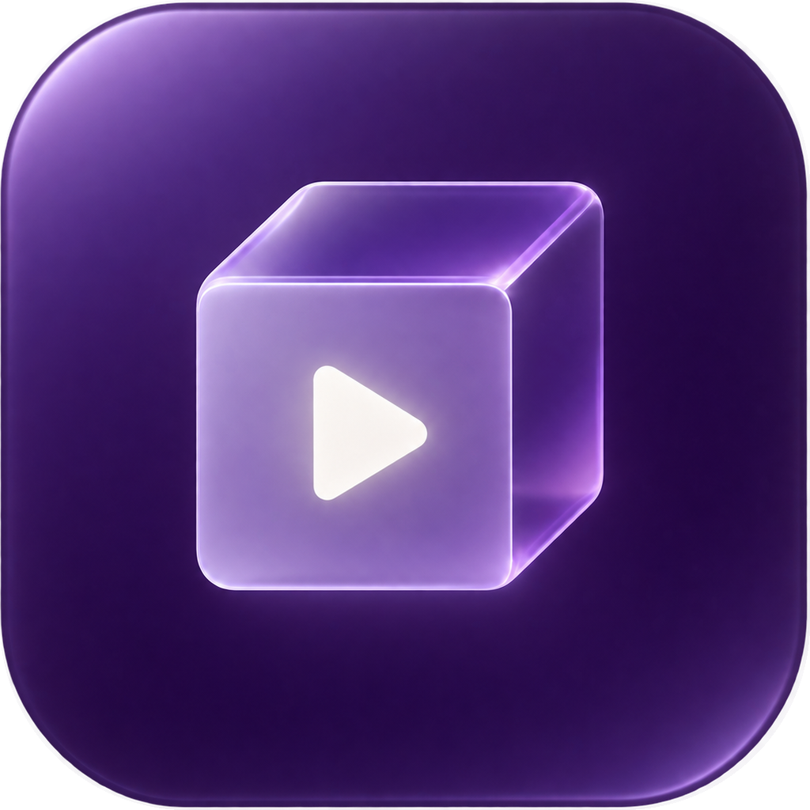

  

<h1 align="center">影盒</h1>

<strong>你的好片，自成一库。</strong>

收藏的电影，追着的剧，还有今晚想看的。 从电脑到客厅，让每一次打开，都离好故事更近。

  <a href="https://github.com/Acefake/yingbox/releases/latest">下载影盒</a> ·
  <a href="docs/deploy/nas-simple.md">部署到 NAS</a> ·
  <a href="docs/library-server.md">了解网页端</a>

---

## 🎬 满满的文件夹。一眼心动的片库。

把电影和剧集交给影盒，让海报、剧情、演员和季集信息各就各位。在海报墙里挑一部，看看预览，再决定今晚看什么。

- **认得你的收藏。** 扫描本地目录，识别片名、季集与多版本，从 TMDB 获取元数据。
- **整理，也有章法。** 按模板整理文件，写入 Kodi 标准 NFO、海报和剧照。
- **换个方式找电影。** 浏览演员资料、查看观看进度，也能按画面搜索本机影片。

## 🔎 想看的，少找一会儿。

从豆瓣发现一部电影，再到配置好的 CMS 与插件源里搜索。统一搜索、选源测速、播放和 HLS 下载，让找片与看片衔接起来。

本地收藏和 115 网盘目录可以分别建库。连接 CloudDrive2 变更通知后，文件有变化，片库便能增量扫描。

## 📅 追的剧，有着落。

把想追的剧加入追更，在日历里查看更新。按剧设置转存目标，转存完成后自动通知媒体库扫描。新一集，从网盘到片库，接着上次的故事。

## ▶️ 好好看，才是正事。

本地文件、HLS、多音轨和外挂字幕，都有对应的播放支持。桌面端使用独立播放窗口，也可以选用 mpv；网页端直接在页面内播放。

影盒可识别 HDR 与杜比视界。实际画面输出取决于片源、播放内核、设备和显示器，具体能力以当前设备的播放诊断为准。

## 📺 从书桌，到沙发。

电脑上整理，手机上挑片，电视上开看。影盒提供桌面、网页和安卓体验，也能把片库部署到 NAS。

| 在哪里用 | 怎样开始 |
| --- | --- |
| 电脑 | 从[发行页面](https://github.com/Acefake/yingbox/releases/latest)选择对应系统的安装包 |
| 安卓手机与电视 | 安装对应 APK，使用原生界面；支持手势与遥控器操作 |
| 浏览器 | 连接已部署的[片库服务](docs/library-server.md) |
| NAS | 按 [NAS 专用版部署指南](docs/deploy/nas-simple.md)安装；需要完整服务与高级配置时，查看 [Docker 部署文档](docs/deploy/nas.md) |

安卓手机与电视可连接 NAS 上的影盒，浏览片库并直接播放。各端能力随设备与部署方式有所不同。

## ✨ 第一部，从这里开始。

1. 从[发行页面](https://github.com/Acefake/yingbox/releases/latest)下载安装包，或按部署指南启动 NAS 服务。
2. 在设置中配置 TMDB 访问令牌，用于获取影片资料与图片。
3. 添加电影或剧集目录，开始扫描。需要在线观看时，再配置数据源。
4. 打开片库，挑一部想看的。

## 💡 为你的想法，留出空间。

影盒开源。欢迎提交问题、改进建议和代码。

## 📖 开放的代码。清楚的授权。

影盒自有代码采用 [MIT 许可证](LICENSE)。

第三方代码、依赖、模型和资源保留各自授权，见[第三方软件声明](THIRD_PARTY_NOTICES.md)与[许可证目录](licenses/)。根目录的 MIT 不替代这些条款；主许可证和第三方声明随桌面发行包一并提供。

Windows 发行包附带固定版本 mpv 的许可、对应源码、补丁和构建记录，见安装目录 `resources/third-party/mpv/` 与[发行记录](docs/release-licenses.md)。

TMDB、豆瓣及用户配置的数据源、媒体和图片另受其服务条款与权利人授权约束；本项目的软件许可证不授予第三方媒体内容的版权。
